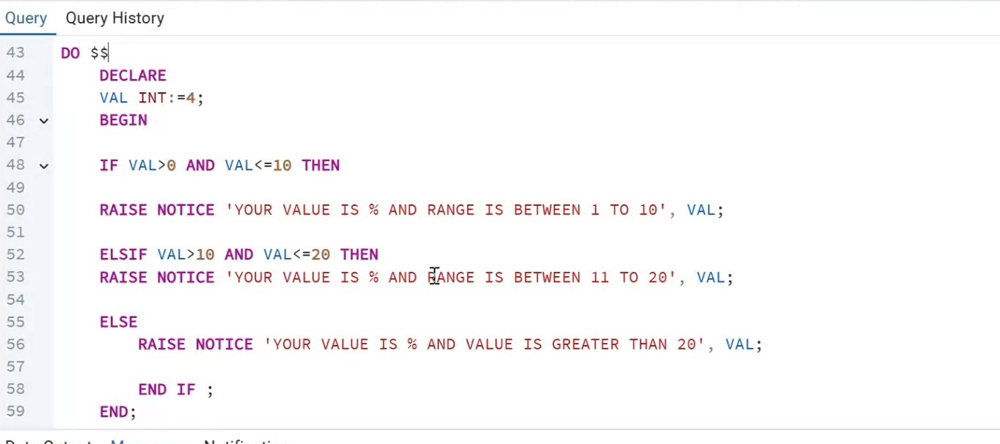

# Experiment 5 - Task 3

Name: Arshdeep Singh

UID: 24BCS10184

## Aim

To classify a number into a range using a PL/pgSQL DO block and conditional statements.

## Question

Write a PL/pgSQL block to check the value of `VAL` and display whether it lies between 1 to 10, 11 to 20, or is greater than 20.

## SQL Queries Used

```sql
DO $$
DECLARE
    VAL INT := 4;
BEGIN
    IF VAL > 0 AND VAL <= 10 THEN
        RAISE NOTICE 'YOUR VALUE IS % AND RANGE IS BETWEEN 1 TO 10', VAL;
    ELSIF VAL > 10 AND VAL <= 20 THEN
        RAISE NOTICE 'YOUR VALUE IS % AND RANGE IS BETWEEN 11 TO 20', VAL;
    ELSE
        RAISE NOTICE 'YOUR VALUE IS % AND VALUE IS GREATER THAN 20', VAL;
    END IF;
END;
$$;
```

## Expected Output

```text
YOUR VALUE IS 4 AND RANGE IS BETWEEN 1 TO 10
```

## Output Screenshot



## Image Explanation

The supplied reference screenshot shows the PL/pgSQL DO block with a declared integer value of 4, but does not show the emitted notice. It is not execution evidence for the expected output above.

Source: [reference Experiment 5 Task 3](https://github.com/RICH-KEED/24BCS10039_ABHINEET_ADBMS/tree/9d579d352a3d9ae6eae24cc03ff01babf52893d0/EXPERIMENTS/EXPERIMENT-5/TASK-3).

## Result

For the sample positive integer `4`, the block selects the 1 to 10 branch. Execution evidence is pending. This exercise assumes a positive input: the inherited `ELSE` branch also accepts zero or negative values, so those inputs require additional validation before reusing the block.
