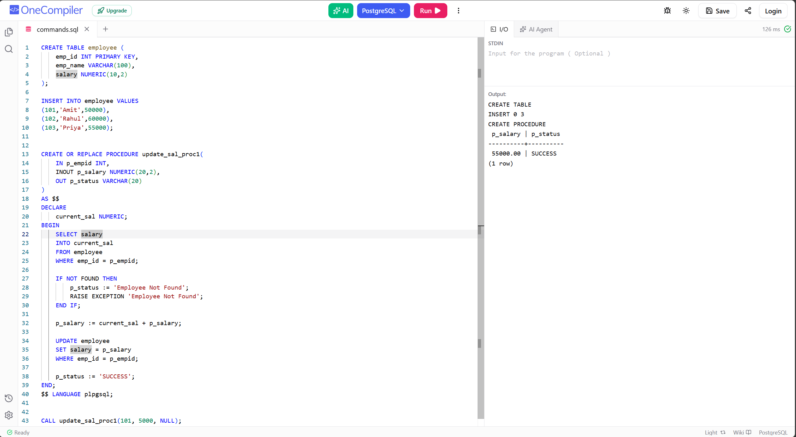

# Experiment 8 - Task 1

Name: Arshdeep Singh

UID: 24BCS10184

## Aim

To create a PostgreSQL procedure that updates an employee's salary using an input salary increment and returns the updated salary and status.

## Question

Create an `employee` table with employee records. Write a PostgreSQL procedure `update_sal_proc1` that accepts employee ID, an increment value, and an output status. If the employee exists, add the increment to the current salary and update the record. Return the updated salary and status.

## Environment and Execution

Use PostgreSQL **14 or later**: this procedure uses an `OUT` parameter, which PostgreSQL 14 introduced for procedures. Experiment 7 uses Oracle PL/SQL and must be run separately.

Run `task.sql` in a fresh database/schema with `psql` or a PostgreSQL SQL editor. The setup creates `employee` and is not repeatable in the same schema without removing the prior objects. Do not run it against an existing employee table.

From this task directory, execute the regression tests with:

```sh
psql -X -v ON_ERROR_STOP=1 -d your_test_database -f tests.sql
```

The tests use a dedicated schema inside a transaction and roll back their changes. `your_test_database` must be an existing database to which you have connection and schema-creation privileges.

## SQL Queries Used

```sql
CREATE TABLE employee (
    emp_id INT PRIMARY KEY,
    emp_name VARCHAR(100),
    salary NUMERIC(10,2)
);

INSERT INTO employee VALUES
(101,'Amit',50000),
(102,'Rahul',60000),
(103,'Priya',55000);

CREATE OR REPLACE PROCEDURE update_sal_proc1(
    IN p_empid INT,
    INOUT p_salary NUMERIC(20,2),
    OUT p_status VARCHAR(20)
)
AS $$
DECLARE
    current_sal NUMERIC;
BEGIN
    SELECT salary
    INTO current_sal
    FROM employee
    WHERE emp_id = p_empid;

    IF NOT FOUND THEN
        p_status := 'Employee Not Found';
        RAISE EXCEPTION 'Employee Not Found';
    END IF;

    p_salary := current_sal + p_salary;

    UPDATE employee
    SET salary = p_salary
    WHERE emp_id = p_empid;

    p_status := 'SUCCESS';
END;
$$ LANGUAGE plpgsql;

CALL update_sal_proc1(101, 5000, NULL);
```

## Expected Output

```text
CREATE TABLE
INSERT 0 3
CREATE PROCEDURE

 p_salary | p_status
----------+----------
 55000.00 | SUCCESS
(1 row)
```

Employee `101` starts with salary `50000`; the procedure adds `5000`, stores `55000.00`, and returns `SUCCESS`. Other employees remain unchanged.

## Missing Employee Behavior

```sql
CALL update_sal_proc1(999, 5000, NULL);
```

This raises `Employee Not Found`. Although the code assigns `p_status` before raising, the exception aborts the call, so it does **not** return a status row for a missing employee. The reference behavior is preserved. The exercise assumes non-null salary/increment values; production input validation and concurrent-update handling are outside its scope.

## Reference Screenshot



This screenshot is copied from the reference repository; it is not evidence of a run under Arshdeep's account. It shows the procedure returning `55000.00` and `SUCCESS` for employee `101`.

## Source

Adapted from [RICH-KEED/24BCS10039_ABHINEET_ADBMS — Experiment 8 Task 1](https://github.com/RICH-KEED/24BCS10039_ABHINEET_ADBMS/tree/9d579d352a3d9ae6eae24cc03ff01babf52893d0/EXPERIMENTS/Experiment-8/TASK-1), pinned to commit `9d579d352a3d9ae6eae24cc03ff01babf52893d0`. Student metadata and environment notes are adapted for this repository; the procedure behavior matches the reference.

## Local Validation and Result

Validated on **2026-10-09** with PostgreSQL **14.19** in an isolated temporary cluster. The sample call returned `55000.00` and `SUCCESS`. All checks in `tests.sql` passed: sample persistence, returned parameters, repeated and decimal increments, zero increment, unchanged employees, and the missing-employee exception. The test schema was absent after rollback.

[Actual local regression-test output](validation-output.txt) is included separately from the reference screenshot. The temporary cluster was stopped and removed after validation.
